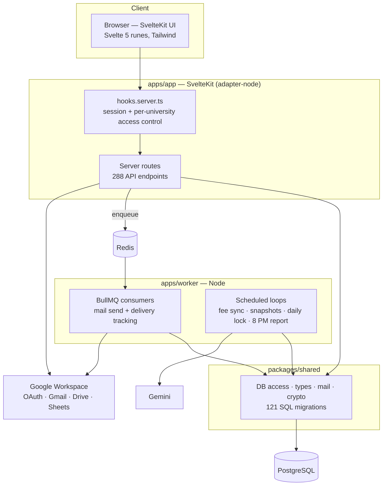

# UniConnect — Campus Operations OS

**An operations platform that replaced the spreadsheets and email threads 42 universities ran on.**

`SvelteKit` · `TypeScript` · `PostgreSQL` · `Redis + BullMQ` · `Google Workspace` · `Gemini` · `pnpm monorepo`

---

## The problem

A higher-education network ran campus operations across dozens of universities
on manual Google Sheets and email threads. Every recurring job — mailing
thousands of students, collecting the daily status of each campus, generating
exam papers, chasing fee payments, approving a ₹2,000 expense — meant someone
copying rows between sheets and sending mail by hand.

That approach broke in three predictable ways. It did not scale with the number
of campuses. Nobody could tell whether a given mail had actually reached a
student. And there was no single place to ask "what happened yesterday, across
the network?"

## What I built

I built UniConnect solo, as creator and product owner: gathering requirements
from the operations, finance and academic teams, designing the data model and
the permission system, writing the application, and running the rollout.

| Module | What it does |
|---|---|
| **Mail campaigns** | Bulk, templated email to filtered student and staff lists, queued through Redis, with per-recipient delivery and open tracking. |
| **Assessments & exam papers** | A question bank with units, topics and course outcomes; a wizard that composes a paper structure; a generator that fills multiple distinct-but-equivalent sets; and 18 per-university paper layouts that print to each institution's own format. |
| **Exam operations** | Exam timetables, classroom seating plans, invigilator allocation and marks entry. |
| **Fee collection** | Per-university collection tracking against a source of truth, day-over-day movement sampled through the working day, and scheduled snapshot emails. |
| **Instructor attendance** | Daily faculty attendance, workload and leave, feeding scheduling eligibility. |
| **Tasks & events** | Assignable tasks with checklists, multiple assignees and a view log, plus campus event tracking. |
| **Budget proposals** | Submission → review → approval, with the approval chain and recipients configured per deployment. |
| **Petty cash** | Two-level approval, disbursement, bill verification and settlement. |
| **Daily ops log** | One structured status record per campus per day, on a draft → submitted → reviewed → signed-off state machine. |
| **Access control** | Per-user and per-university scoping, so a campus manager sees only their own campuses while central teams see everything. |
| **Gemini daily report** | An LLM-written narrative summary of the day across the network, generated and mailed automatically at 8 PM. |

## Architecture

A pnpm + Turborepo monorepo. The SvelteKit app serves both UI and API; a
separate worker process owns everything on a schedule, so no background job
depends on a browser being open. Shared types, database access and services
live in one package used by both.



**Why these choices.** SvelteKit keeps UI and API in one deployable with shared
types end to end. Mail goes through a Redis queue rather than the request cycle,
so a 3,000-recipient campaign cannot time out a browser tab and failures retry
on their own. Scheduled work lives in a separate process so it survives
deploys and doesn't compete with user requests. Postgres over an ORM-heavy
stack because the reporting queries are the hard part and are written as SQL.

## Outcomes

- Used across **42 universities** by **111+ users**.
- Bulk communications: **~3 hours → under 5 minutes**.
- Reporting: **~30 minutes → under 2 minutes**.
- Marks entry: **2–3 hours → ~20 minutes**.

## Status

Active. Features are being merged into the organisation's main Campus OS
portal; this repository is the standalone implementation.

## Running it locally

Requires Node 20+, pnpm 8, PostgreSQL and Redis.

```bash
pnpm install
cp .env.example .env     # then fill in the values
pnpm --filter @uniconnect/shared migrate
pnpm dev
```

`.env.example` documents every variable the app reads, with placeholder values.
At minimum set `DATABASE_URL`, `REDIS_URL`, `ENCRYPTION_KEY_BASE64` and the
`GOOGLE_*` OAuth credentials; the rest enable optional integrations.

**Push notifications (optional).** The Firebase web config is read from
`PUBLIC_FIREBASE_*` variables. A service worker cannot read environment
variables at runtime, so if you enable push you must also replace the
placeholders in `apps/app/static/firebase-messaging-sw.js` by hand with the
same values. Leaving them disables background push only.

## Repository layout

```
apps/
  app/              SvelteKit application — UI + 288 API endpoints
  worker/           scheduled jobs and queue consumers
  qr-attendance/    standalone QR attendance app (Next.js)
  chrome-extension/ meeting tracker
  niat-planner/     planning prototype
packages/
  shared/           database access, types, mail, crypto, 121 migrations
docs/               operational guides and HTML templates
```

## A note on this repository

This is a sanitised public copy. It contains no production data, no
credentials, and no personal information: every operational email address,
approver list and recipient list is configured through environment variables,
and all sample data is fictional.
